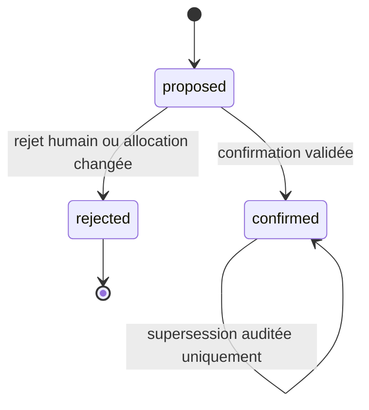

# Allocations et remboursements

Ce document décrit les services métier T17 et leur représentation dans SQLite.
Ils ne réécrivent jamais une transaction bancaire, sa date, son montant, son
compte ou ses libellés. Les endpoints de revue relèvent de T21.

## Montants et splits exacts

Tout montant est un entier strict de centimes : débit négatif, crédit positif.
Les calculs financiers n'utilisent ni `float` ni conversion intermédiaire en
flottant.

`app.domain.money_split.split_by_basis_points(amount_cents, parts)` reçoit des
paires `(category_id, basis_points)`. Les poids sont strictement positifs et leur
somme vaut exactement `10000`. Les catégories répétées sont fusionnées. Le
calcul traite les poids du plus grand au plus petit puis par ID catégorie
croissant ; chaque part sauf la dernière est arrondie au centime le plus proche,
demi loin de zéro, et la dernière reçoit le reste signé. Une part nulle ou de
signe contraire rejette tout le split.

`split_by_amounts(amount_cents, parts)` valide une ventilation signée exacte et
fusionne les catégories répétées. `prorate_link(amount_cents, allocations)`
reçoit un avoir positif et des allocations `expense` négatives. Il applique la
méthode des plus grands restes en centimes entiers, avec les montants bruts par
catégorie comme plafonds. Les ex æquo sont départagés par ID catégorie
croissant ; une part nulle est valide. Une capacité insuffisante lève
`REFUND_PRORATA_INFEASIBLE` sans écrire de lien confirmé.

À la confirmation, `prorate_link_bounded()` utilise les capacités restantes
après les remboursements déjà confirmés. Une catégorie plafonnée est retirée du
calcul et sa part est redistribuée au prorata sur les capacités encore
disponibles ; les restes sont redistribués par ordre décroissant de reste puis
par ID. Le résultat vérifie toujours `Σ parts = montant du lien` et
`0 ≤ part catégorie ≤ capacité restante`. Si le total des capacités est trop
petit, le service refuse le lien avec `REFUND_PRORATA_INFEASIBLE` ; il ne réduit
pas silencieusement le remboursement.

Vecteurs ADR-007 : `-1101` à `7000/3000` donne `-771/-330` ; `-10001` à
`5000/3000/2000` donne `-5001/-3000/-2000`. `7000/2999` est rejeté avant toute
écriture.

## Allocations confirmées et retrait auditable

`app.services.allocations.allocate(engine, transaction_id, parts, *, mode,
origin, actor, expected_version)` écrit sous `write_transaction()` (`BEGIN
IMMEDIATE`). Chaque `AllocationPart` contient `flow_kind`, `category_id`,
`amount_cents` et les dimensions facultatives `beneficiary`, `cadence`,
`flexibility` et `acquisition` (valeur par défaut `unknown`). La matrice T16, la
direction de la catégorie, le signe bancaire et les dimensions sont vérifiés
avant l'insertion. `unknown` est un flux dérivé du résidu ; ce n'est jamais une
allocation.

- `mode="complete"` exige que la somme signée égale le montant bancaire au
  centime près.
- `mode="partial"` laisse un résidu signé visible et refuse toute
  sur-allocation. `get_allocation_state()` renvoie `unclassified`, `partial` ou
  `complete`, les allocations confirmées, le résidu et les flux dérivés. Tout
  résidu non nul ajoute `unknown`.
- `origin` vaut `manual`, `rule`, `history` ou `llm`. Une règle ne peut classer
  qu'une transaction sans allocation ni décision antérieure. Les origines
  `history` et `llm` ne remplacent pas une allocation effective. Un appel
  `manual` constitue la confirmation humaine explicite d'une proposition.
- Un appel identique ne crée ni ligne ni audit et ne change pas la version.
  Chaque écriture effective vérifie `expected_version` puis avance la version
  optimiste de la transaction. Une version périmée lève
  `VersionConflictError`.
- Une allocation manuelle active résiste à toute demande `rule`, `history` ou
  `llm`, qui lève `HUMAN_DECISION_PROTECTED`. Une correction manuelle crée de
  nouvelles lignes, une `classification_decision` avec avant/après et un
  `audit_event`. L'ancienne allocation reste historisée.
- `clear_allocations()` retire toutes les allocations actives en renseignant
  `retracted_at_utc` et `retracted_by_decision_id`. La décision `clear` contient
  l'instantané avant retrait ; l'audit porte l'action `allocation.retracted`.
  Les lignes retirées restent immuables et ne contribuent plus aux sommes, au
  résidu ou aux métriques. L'opération fait avancer la version de la transaction
  et permet de revenir à `unclassified` sans toucher aux données bancaires.
  Répéter un retrait déjà effectué avec la version courante ne crée pas de
  nouvelle décision ni d'événement d'audit. Une décision de rollback T20 peut
  restaurer le contenu de `before_json` en créant de nouvelles allocations
  actives ; elle ne réactive ni ne modifie les anciennes lignes.
- Une proposition de remboursement ne verrouille pas une allocation. Lorsqu'une
  réallocation ou un retrait change l'une des jambes d'un lien `proposed` actif,
  le service le rejette automatiquement dans la même transaction, avance sa
  version et consigne `refund_link.rejected` avec `reason=allocation_changed`.
  La proposition reste visible dans l'historique et peut être rejetée de nouveau
  sans erreur SQL. La transition de statut suit le trigger décrit ci-dessous.
- Un lien `confirmed` actif protège toujours les allocations source et cible
  qu'il consomme. Il ne peut évoluer que par supersession auditée ; son
  remplacement conserve le crédit source et son allocation. Un retrait reste
  refusé tant qu'un lien confirmé actif dépend de l'allocation concernée.

Le remplacement respecte n-11 de la revue G0 : l'ancienne allocation est
marquée `superseded_by_allocation_id` avant l'insertion des nouvelles lignes.
Les deux références différées sont validées au commit. Cette séquence libère le
plafond d'allocation du trigger avant l'insertion des remplacements.

Les erreurs de validation sont des `AppError` avec des codes stables, notamment
`ALLOCATION_INVALID`, `ALLOCATION_CATEGORY_FLOW_INVALID`,
`ALLOCATION_SIGN_INVALID`, `ALLOCATION_TOTAL_MISMATCH`,
`ALLOCATION_TOTAL_EXCEEDED`, `HUMAN_DECISION_PROTECTED`,
`ALLOCATION_HAS_CONFIRMED_REFUND_LINK`, `ALLOCATION_HAS_PROPOSED_REFUND_LINK` et
`RULE_REQUIRES_UNCLASSIFIED_TRANSACTION`.

## Remboursements `refund_of`

`create_refund_link()` crée une proposition. La source doit être un crédit avec
une allocation active `refund` positive ; chaque lien conserve son
`source_allocation_id`. La cible doit être un débit avec une ou plusieurs
allocations actives `expense`. Source et cible doivent appartenir au même
compte ; le service comme le trigger SQL refusent un lien inter-comptes.

Un `target_allocation_id` cible une allocation expense active précise. Sans
cible, le lien est réparti entre les catégories expense au prorata de leurs
poids absolus, avec l'ordre et l'arrondi ADR-007. À la confirmation, les parts
en centimes sont figées dans `refund_link_allocation_parts`, référencées aux
allocations expense actives. Si plusieurs allocations ont la même catégorie,
la part calculée pour cette catégorie est distribuée entre elles par ID
d'allocation croissant, sans dépasser leur capacité. La somme des parts
matérialisées égale le montant positif du lien.

Le service est l'unique chemin d'écriture supporté pour cette vectorisation :
il calcule les parts ADR-007 en centimes entiers, les matérialise pendant que le
lien est proposé, puis confirme dans la même transaction. SQLite vérifie leur
positivité, leur appartenance à des allocations expense actives de l'achat, leur
somme exacte et les plafonds combinés ; le trigger ne recalcule pas la formule
de prorata. Une écriture SQL directe de parts est donc hors contrat : elle peut
choisir une attribution non proportionnelle, même si les gardes SQL empêchent
un net négatif par allocation.

Les plafonds d'un lien confirmé sont contrôlés sous le verrou d'écriture et dans
les triggers SQL :

- par allocation source, la somme de ses liens `refund_of` actifs est au plus le
  montant de cette allocation `refund` ; plusieurs allocations source et
  plusieurs achats peuvent être liés au même crédit ;
- par achat, la somme globale des liens actifs est au plus la somme absolue de
  ses allocations `expense` actives ;
- par allocation expense, la consommation cumulée comprend les montants des
  liens ciblés directement et les parts matérialisées des liens proratisés.
  Cette somme ne dépasse jamais la valeur absolue de l'allocation. Le calcul de
  lecture utilise les mêmes parts matérialisées, donc le net par catégorie ne
  peut pas devenir négatif sur les dépenses de cet achat ;
- les propositions ne consomment aucun plafond. À la confirmation, les plafonds
  sont recalculés sous `BEGIN IMMEDIATE`, puis vérifiés à nouveau par SQLite.

`reject_refund_link()` rejette une proposition et la conserve dans l'historique.
`replace_refund_link()` remplace un lien confirmé actif par supersession,
version et audit avant/après. La supersession conserve le crédit source et son
`source_allocation_id` selon le trigger SQL ; une demande de changement de cette
allocation échoue avec `REFUND_SOURCE_ALLOCATION_IMMUTABLE` (409). La cible et le
montant du lien peuvent être corrigés. Un lien confirmé n'est jamais modifié en
place ni supprimé. Répéter une confirmation, une proposition identique ou le
même remplacement retourne le résultat déjà créé sans doubler l'audit. Les
versions périmées lèvent `VersionConflictError` ; `BEGIN IMMEDIATE` sérialise
les confirmations et remplacements concurrents.

L'index d'unicité ne porte que sur les lignes `proposed` ou `confirmed` non
supersédées, pour le couple source/allocation source/cible/type/allocation cible.
Les liens `rejected` et les liens supersédés restent historisés et ne bloquent
pas une nouvelle proposition.

Machine d'états imposée au niveau SQL pour `refund_of` :

`confirmed → proposed`, `confirmed → rejected`, `rejected → confirmed` et
`rejected → proposed` sont interdits ; une ligne `refund_of` ne peut être
insérée qu'en `proposed`. Une réallocation rend une proposition
obsolète en la faisant passer à l'état terminal `rejected`; elle ne crée pas un
nouvel état de schéma.

`net_effect_by_category(engine, purchase_transaction_id, account_ids=...)`
retourne les coûts de catégorie positifs après remboursements confirmés. Seul
un lien `confirmed` actif contribue. Si un périmètre explicite est fourni, les
deux jambes doivent y figurer ; sinon l'avoir reste non attribué dans ce
résultat et son montant est signalé dans
`ignored_out_of_scope_refunds_cents`. Exemple : achat `-10000`, avoir confirmé
`+2000` sur la même catégorie → consommation nette `8000`; le flux bancaire de
la paire reste `-8000`.

Les erreurs de lien comprennent `REFUND_LINK_DIRECTION_INVALID`,
`REFUND_SCOPE_MISMATCH`, `REFUND_SOURCE_CAP_EXCEEDED`,
`REFUND_TARGET_CAP_EXCEEDED`, `REFUND_TARGET_ALLOCATION_CAP_EXCEEDED` et
`REFUND_LINK_CONFIRMED_PROTECTED`, `REFUND_PRORATA_INFEASIBLE` et
`REFUND_LINK_CONFLICT`.
