# Architecture et schéma relationnel v1

**Version :** proposition T02 · **Gate :** G0 · **Références :** PLAN §D, §F LOT 0–6 ; ADR-001, ADR-003, ADR-005..009, ADR-017..023 ; `docs/IMPORT_CONTRACT.md`.

Le système est une application mono-utilisateur, locale et utilisable hors ligne. Le backend Python/FastAPI est l'unique propriétaire des écritures, règles, calculs financiers et secrets. SQLite conserve une provenance immuable des mouvements ; React/TypeScript ne fait que filtrer et présenter les réponses typées.

## Modules et dépendances

```text
frontend React/TypeScript
  app/router, pages, components, lib/api, filters, money, dates
         │ HTTP JSON /api/v1 (multipart uniquement pour les fichiers)
         ▼
backend/app/api/v1/{health,imports,accounts,transactions,categories,
                   rules,review,analytics,insights,settings,backups}.py
         │ Pydantic + core/errors + core/security + services
         ├── services/{imports,allocations,review,backups}.py
         ├── importers/{credit_agricole,encoding,normalize,overlap}.py
         ├── classification/{engine,matcher,rule_store,suggestions,
         │                  llm_text_parser,llm_client}.py
         ├── analytics/{definitions,queries,quality,series,forecast}.py
         ├── domain/{types,entities,metrics}.py
         └── db/{base,session,models}.py → SQLite + Alembic
```

Les noms de modules suivent PLAN §D. Le service d'import orchestre parser, normalisation et algorithme de multiplicité ; le parser ne connaît pas les décisions d'allocation. Le service d'allocation ne change jamais les colonnes sources. Les règles approuvées ont une portée et passent par dry-run/audit. Les propositions heuristiques et LLM restent en revue ; la sortie du modèle est du texte souple selon `PROTOCOLE_LLM_TOLERANT.md`, puis validée par le domaine.

## Modèle relationnel

`docs/examples/schema.sql` est la référence SQL exécutable. Chaque connexion, y compris pool SQLAlchemy et Alembic, active `PRAGMA foreign_keys=ON` **et** `PRAGMA recursive_triggers=ON` dans un hook `connect`; ces PRAGMA sont locaux à chaque connexion. `INSERT OR REPLACE`/`REPLACE INTO` sont interdits dans le code applicatif et contrôlés par garde lint/grep. Les montants sont liés par le service uniquement si `type(value) is int`; le schéma vérifie `typeof(...)= 'integer'` et les règles de signe, jamais `REAL`. Les clés métier financières conservent aussi des colonnes distinctes, plutôt qu'un hash comme unique preuve. Les colonnes métier qui changent concurremment portent `version`.

```mermaid
erDiagram
    accounts ||--o{ import_account_sections : identifies
    import_files ||--o{ import_account_sections : contains
    import_files ||--o{ import_rejections : records
    import_files ||--o{ source_rows : records
    import_account_sections ||--o{ source_rows : locates
    accounts ||--o{ transactions : owns
    transactions ||--o{ source_rows : provenance
    transactions }o--o| payees : attributed_to
    payees ||--o{ payee_aliases : aliases
    transactions ||--o{ allocations : split_into
    categories ||--o{ category_flow_kinds : allows
    category_flow_kinds ||--o{ allocations : validates
    transactions ||--o{ classification_suggestions : suggested_for
    transactions ||--o{ classification_decisions : decided_for
    transactions ||--o{ transaction_links : source_or_target
    rules ||--o{ rule_executions : executed_as
    transactions ||--o{ rule_executions : evaluated_on
    audit_events o|--o{ rule_executions : traces
    import_files ||--o{ audit_events : audited
    transactions ||--o{ import_reconciliation_candidates : candidate_for
    source_rows ||--o{ import_reconciliation_candidates : flagged_by
    llm_runs ||--o{ classification_suggestions : proposes
    budgets ||--o{ budget_accounts : scopes
    accounts ||--o{ budget_accounts : selected_for
    categories ||--o{ budgets : budgets
    app_settings {
        string setting_key PK
    }
    idempotency_records {
        string idempotency_key PK
    }
    backup_manifests {
        string backup_manifest_id PK
    }
    insights {
        string insight_id PK
    }
    insight_facts {
        string insight_fact_id PK
        string metric_definition_id
    }
    insight_fact_transactions {
        string insight_fact_id PK, FK
        string transaction_id PK, FK
    }
    insights ||--o{ insight_facts : contains
    insight_facts ||--o{ insight_fact_transactions : drills_down
    transactions ||--o{ insight_fact_transactions : used_by
```



Le modèle comprend toutes les tables du plan : `accounts`, `import_files`, `import_account_sections`, `source_rows`, `transactions`, `payees`, `payee_aliases`, `categories`, `allocations`, `classification_suggestions`, `classification_decisions`, `rules`, `rule_executions`, `transaction_links`, `audit_events`, `app_settings`, `llm_runs`, `budgets`, `insights`, `backup_manifests`. Il ajoute `category_flow_kinds` pour rendre la matrice `flow_kind`↔catégorie vérifiable par FK, `idempotency_records` (rétention 7 jours) pour rejouer les mutations HTTP, `import_rejections` pour les diagnostics/résolutions sans extrait privé, `import_reconciliation_candidates` pour garder les rapprochements approximatifs en audit, `budget_accounts` pour les périmètres multi-comptes, `insight_facts` pour les faits métriques normalisés et `insight_fact_transactions` pour leurs drilldowns. Les réponses qui restent ambiguës gardent leurs transactions distinctes.

La clé logique de transaction est le tuple `(account_id, booked_on, amount_cents, identity_label)` avec rang d'occurrence ; l'unicité SQL ajoute `occurrence_rank`, et un trigger impose la contiguïté `1..max`. `transactions` ne stocke aucun `flow_kind` : les flux viennent des allocations confirmées et tout résidu non nul est `unknown`. `source_rows` est une relation plusieurs-vers-un, unique par fichier et transaction, et chaque import distinct apporte une provenance par occurrence. Des triggers vérifient compte/section, statut du fichier, état final des sources, allocations et liens de remboursement. Les triggers bloquent la mise à jour des colonnes sources de `transactions`, toute modification/suppression de `source_rows`, ainsi que la modification/suppression des événements d'audit. Une correction d'allocation se fait par supersession auditée, jamais par écrasement.

### Flux d'écriture et de lecture

```mermaid
flowchart LR
    CSV[Octets CSV] --> P[Preview : décodage et validation]
    P --> M[Mapping explicite des sections vers accounts]
    M --> C[Commit : BEGIN IMMEDIATE]
    C --> H[Lecture du hash sous verrou et no-op éventuel]
    H --> I[Sections, génération, couverture et solde]
    I --> R[Réconciliation max des multiplicités]
    R --> T[Transactions manquantes + source_rows]
    T --> A[Audit et commit SQL unique]
    T --> Q[Suggestions / revue / décisions]
    Q --> L[Allocations signées et versionnées]
    T --> D[Définitions analytiques backend]
    L --> D
    D --> API[Réponses typées avec drilldown]
```



**Import :** l'aperçu parse CP1252/UTF-8 et les sections sans écrire de transactions. Il masque les numéros de compte, montre le mapping humain, les plages, anomalies, date de génération et `complete_through`. Toute section non mappée, plage inconnue, multiplicité à trancher ou ligne `OUT_OF_PERIOD` non résolue bloque le commit du fichier entier ; deux sections mappées au même compte sont rejetées. Le SHA-256 porte sur les octets exacts reçus. Le service écrit l'archive brute sous permissions `0600`, ouvre une connexion autocommit, démarre `BEGIN IMMEDIATE`, puis lit le hash sous verrou. Hash déjà commité → tentative `no_op`; sinon une seule transaction écrit toutes les sections, transactions, `source_rows` et audits. Les seuls statuts sont `previewed`, `committed`, `rejected`, `no_op`; pas de résultat `partial`.

**Ventilation :** les opérations bancaires sources sont immuables. Une règle approuvée peut créer des allocations confirmées après aperçu ; les triggers garantissent le signe identique à la transaction, le plafond du montant, le sens des catégories directionnelles et l'immutabilité d'une allocation confirmée. Une correction supersède les lignes précédentes par `superseded_by` avec audit. Mémoire, heuristique et IA produisent des suggestions. Annulation restaure la décision analytique précédente, pas le CSV.

**Analytique :** les endpoints interrogent une définition versionnée dans `analytics/definitions.py`; ils réutilisent les filtres compte/période/`mode`/`personal_mode` et retournent les IDs de transactions de drilldown. `personal_mode=envelope|observed` empêche de compter à la fois les allocations personnelles et les dépenses observées du compte personnel. Un `refund_of` confirmé réduit la catégorie de l'achat à la date de l'avoir seulement quand les deux comptes sont sélectionnés ; les plafonds relationnels interdisent le sur-appariement. React ne recompute ni centimes ni KPI. Les réponses distinguent `0` connu de `null` inconnu et incluent couverture, exclusions et définition de métrique (INV-09/10).

## Contrat de sécurité et de confidentialité locale

- Le serveur écoute exclusivement sur `127.0.0.1`. CORS est minimal. Toutes les mutations valident `Origin` contre l'origine locale attendue **et** un jeton anti-CSRF non prédictible ; `Host`, chemin d'archive et taille d'upload sont validés côté serveur.
- `GET /api/v1/health` n'ouvre pas de réseau externe et reste disponible sans configuration LLM. Aucun appel sortant n'a lieu si l'utilisateur n'a pas activé explicitement le fournisseur et confirmé le contenu transmis.
- Numéros de compte : HMAC local stable décrit dans `IMPORT_CONTRACT.md`, sans stockage ou log du numéro. Les octets originaux sont archivés bit-à-bit, sans chiffrement applicatif en v1, sous `data/originals/`, ignoré par Git et avec permissions POSIX `0600`. Le backend ne renvoie jamais l'archive ni son chemin au navigateur et ne les journalise pas.
- Les libellés bancaires et textes LLM sont des données non fiables : jamais exécutés ni interprétés comme HTML. Les logs contiennent codes, IDs opaques et compteurs, pas de libellés, corps de requête, secrets ou détails de fichier.
- SQLite et les archives d'import brutes sont locales et ignorées par Git. Une sauvegarde exportée est un artefact distinct : elle suit sa propre protection et préserve les clés nécessaires aux empreintes ; la restauration se vérifie sur une base distincte avant remplacement.

## Identifiants, temps, taxonomie et audit

- Les clés des entités sont des UUID aléatoires en texte (`UUIDv4`) générés côté backend : stables, opaques, sans dépendance au numéro bancaire ni exposition d'un compteur. Les dates de transaction sont des dates de relevé `YYYY-MM-DD`, sans fuseau horaire. Les instants techniques sont UTC ISO-8601 avec `Z` (`*_at_utc`).
- Les catégories sont copiées dans `categories` avec leur ID source stable et `taxonomy_version`. `category_flow_kinds` matérialise la matrice exhaustive de `DOMAIN_MODEL.md` ; les catégories désactivées ne sont pas supprimées et gardent les allocations historiques. Toute évolution d'ID requiert une migration et un arbitrage.
- `audit_events` est append-only et conserve acteur, action, type/ID cible et instant UTC, avec représentation `before_json`/`after_json` pour décisions, règles, imports, restauration et actions de masse. Les montants embarqués dans ces représentations restent des entiers `*_cents`; aucune sérialisation flottante.

## Migrations Alembic

1. Une seule personne est propriétaire des migrations du ticket/lot ; les autres changements de modèle lui sont transmis avant génération de révision. Une branche de migration a un parent unique et des révisions monotones, avec contrôle explicite de `alembic heads`.
2. Avant `upgrade`, créer une sauvegarde SQLite cohérente via l'API de backup (WAL inclus, clé HMAC locale incluse, archive de sauvegarde protégée en `0600`), la vérifier (`integrity_check`) et vérifier l'espace disponible. Une migration s'exécute dans une transaction quand SQLite le permet ; reconstruction de table documentée et testée sur copie pour les opérations non transactionnelles.
3. Chaque révision a `upgrade()` et un `downgrade()` raisonnable pour environnements de développement/fixtures. Un downgrade utilisateur n'est autorisé que s'il préserve les données ; si une transformation est irréversible, le downgrade échoue explicitement avec instruction de restaurer une sauvegarde validée ou d'appliquer une migration corrective vers l'avant.
4. Une migration déjà appliquée à une base utilisateur n'est jamais éditée/réécrite. Toute correction crée une nouvelle révision ; les tests couvrent DB neuve, upgrade depuis la révision précédente et downgrade sur fixture.
5. Aucun changement de taxonomie, identity key, `flow_kind` ou contrat API n'est caché dans une migration : révision, backfill exact, audit et stratégie de rollback sont documentés.

Les choix d'identifiants, pagination, idempotence et propriété des migrations suivent les arbitrages acceptés ADR-013..016, ADR-017..023 au gate G0. `idempotency_records` est purgée au démarrage après 7 jours ; l'API ne promet le rejeu que dans cette fenêtre.
